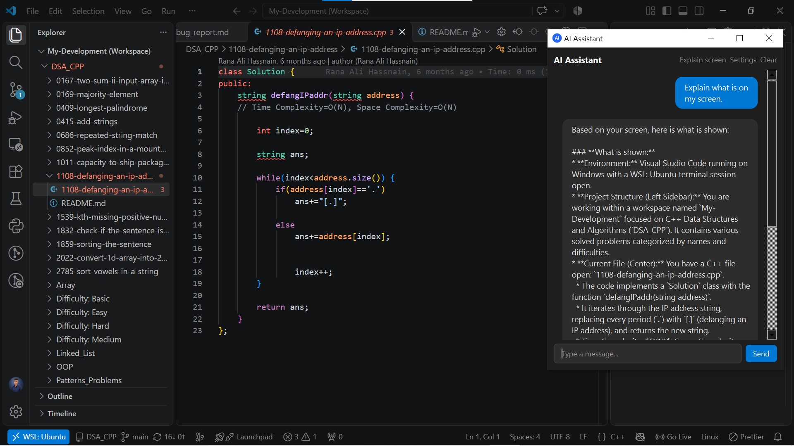
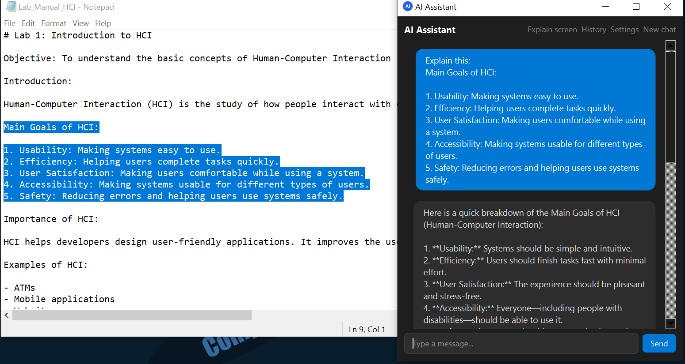
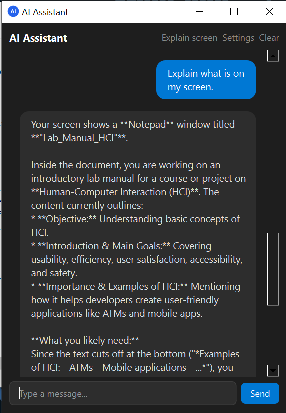
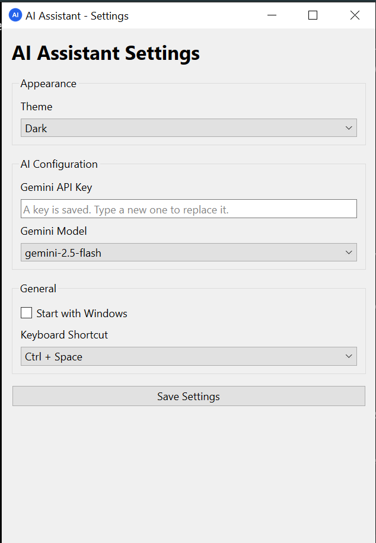
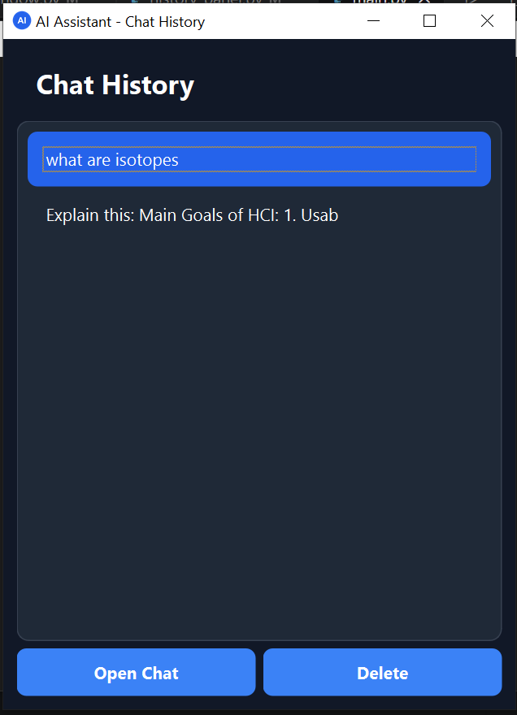
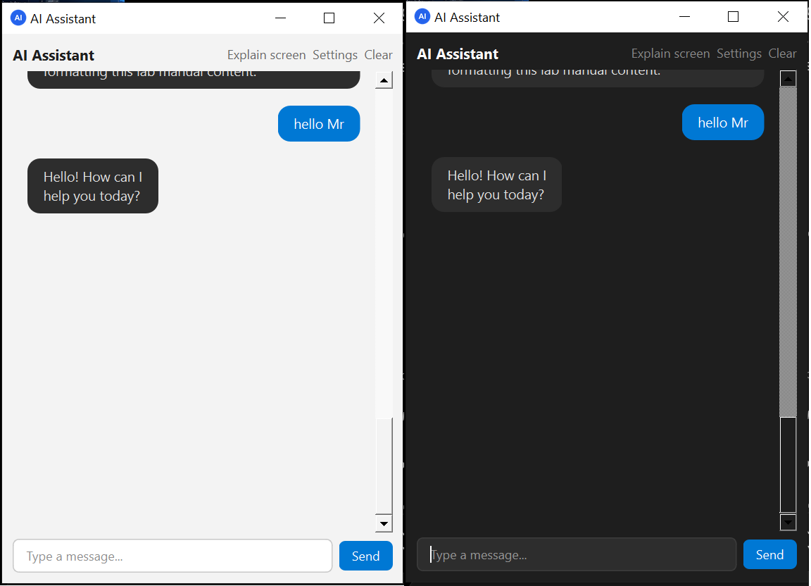

# Desktop AI Assistant

A small AI assistant for Windows that **lives on your screen** instead of in a browser tab.

You are coding in VS Code, watching a lecture in Edge, or solving a problem on LeetCode and something is not clear. Press a hotkey (or click the floating bubble), a small chat window opens on top of whatever you are doing, and you can ask right there. No tab switching, no copy and paste.

> Academic project for the Artificial Intelligence course, built by a team of three.

<!-- SCREENSHOT: main demo picture (chat window open over VS Code) -->


---

## Contents

- [Features](#features)
- [Screenshots](#screenshots)
- [Installation](#installation)
- [Getting a Gemini API key](#getting-a-gemini-api-key)
- [Offline mode with Ollama](#offline-mode-with-ollama)
- [Usage](#usage)
- [How it works](#how-it-works)
- [Tech stack](#tech-stack)
- [Project structure](#project-structure)
- [Running the tests](#running-the-tests)
- [Troubleshooting](#troubleshooting)
- [Known limitations](#known-limitations)
- [Future work](#future-work)
- [Team](#team)

---

## Features

<!-- Delete any line below that did not make it into v1.0.0 -->

- **Global hotkey:** press `Ctrl+Space` in any app to open the assistant
- **Floating bubble and tray icon:** always available, draggable, never in the way
- **Explain selected text:** select text anywhere, press the hotkey, get an explanation
- **Explain my screen:** one click sends a screenshot to the AI
- **Context awareness:** detects VS Code, a browser or another app and adapts the answer style (coding help, lecture explanations, general answers)
- **Streaming answers:** text appears word by word
- **Markdown and code blocks:** formatted answers with a copy button
- **Chat history:** saved locally in a SQLite database
- **Cloud AI and local AI:** Google Gemini online, Ollama offline
- **Secure API key:** stored in Windows Credential Manager, never in the code
- **Dark and light themes**
- **Start with Windows**

---

## Screenshots

<!-- Ask Member A for these. Save them in docs/images/ with exactly these names. -->

| Chat window | Explain selected text |
|---|---|
|  |  |

| Explain my screen | Settings |
|---|---|
|  |  |

| Chat history | Dark and light theme |
|---|---|
|  |  |

---

## Installation

### Option 1: Installer (recommended)

No Python needed.

1. Open the [Releases page](https://github.com/ali-hassnain-se/Academic-Projects/releases) and download **`DesktopAIAssistant-Setup.exe`** from the latest release.
2. Double-click it.
3. Windows may show **"Windows protected your PC"** because the installer is not code-signed. This is expected for student projects. Click **More info**, then **Run anyway**.
4. Follow the setup wizard (optionally tick *Start with Windows*).
5. Start **Desktop AI Assistant** from the Start menu.
6. On first start, open **Settings** and paste your Gemini API key (see [below](#getting-a-gemini-api-key)).

To uninstall: **Settings > Apps > Installed apps > Desktop AI Assistant > Uninstall**.

### Option 2: Run from source

Requirements: Windows 10/11, [Python 3.12](https://www.python.org/downloads/) (tick **Add python.exe to PATH**), [Git](https://git-scm.com/download/win).

```bash
git clone https://github.com/ali-hassnain-se/Academic-Projects.git
cd Academic-Projects/desktop-ai-assistant
```

Git Bash:
```bash
python -m venv venv
source venv/Scripts/activate
pip install -r requirements.txt
```

PowerShell:
```powershell
python -m venv venv
venv\Scripts\Activate.ps1
pip install -r requirements.txt
```

Check the setup and start the app:
```bash
python tests/manual/check_env.py
python main.py
```

> Run it on **Windows**, not in WSL. The hotkey, screenshot and overlay features need the Windows desktop.

---

## Getting a Gemini API key

The assistant uses Google's Gemini models. The key is free.

1. Open [Google AI Studio](https://aistudio.google.com/apikey) and sign in with a Google account.
2. Click **Create API key** and copy the key.
3. Start the assistant, open **Settings**, paste the key and save.

The key is stored in **Windows Credential Manager** on your computer. It is never written into the program files.

Good to know:
- The free tier has limits on requests per minute and per day. If you reach them the assistant shows a "rate limit" message. Wait a little or switch to Ollama.
- Never share your key or post it in a chat, issue or commit. If it leaks, delete it in Google AI Studio and create a new one.

---

## Offline mode with Ollama

Ollama runs an AI model on your own computer: no internet, no key, no request limits. It needs a reasonably modern PC (8 GB RAM or more is recommended).

1. Install Ollama from [ollama.com/download](https://ollama.com/download).
2. Open a terminal and download a model, for example:
   ```bash
   ollama pull llama3.2
   ```
3. Check that it works:
   ```bash
   ollama run llama3.2
   ```
   Type a question, then `/bye` to leave.
4. In the assistant, open **Settings** and choose **Ollama** as the provider.

Notes:
- Ollama must be running in the background (it normally starts automatically after installation; look for its icon in the tray).
- **Explain my screen** needs a model that understands images (a "vision" model). Look for one at [ollama.com/library](https://ollama.com/library). Normal text models answer text questions only.
- Local models are usually slower and less accurate than Gemini.

---

## Usage

| Action | How |
|---|---|
| Open the assistant | `Ctrl+Space` in any app, click the floating bubble, or use the tray icon |
| Ask a question | Type it and press `Enter` (`Shift+Enter` for a new line) |
| Explain selected text | Select text in any app, then press the hotkey |
| Explain my screen | Click **Explain my screen** |
| Copy an answer or a code block | Click **Copy** |
| Open old chats | Click **History** |
| Start a new chat | Click **New chat** |
| Close the window | `Esc` |
| Start with Windows | Turn on **Start with Windows** in Settings |
| Quit completely | Tray icon > **Quit** |

The default hotkey is set in `assistant/config.py` (`DEFAULT_HOTKEY`).

---

## How it works

```
Hotkey / bubble click
        |
        v
Capture (selected text, screenshot, active app)
        |
        v
GUI window  --->  AI client (Gemini or Ollama)  --->  streamed answer
                         |
                         v
                  SQLite chat history
```

Full diagrams: [docs/architecture.md](docs/architecture.md)

---

## Tech stack

| Part | Technology |
|---|---|
| Language | Python 3.12 |
| GUI | PySide6 (Qt for Python) |
| AI (cloud) | Google Gemini API (`google-genai`) |
| AI (local) | Ollama |
| Global hotkey | `pynput` |
| Clipboard | `pyperclip` |
| Screenshot | `mss` and `Pillow` |
| Active window | `pywin32` and `psutil` |
| Secure key storage | `keyring` |
| Chat history | SQLite |
| Markdown rendering | `markdown` and `Pygments` |
| Tests | `pytest` |
| Packaging | PyInstaller and Inno Setup |

---

## Project structure

```
desktop-ai-assistant/
├── main.py                  # entry point
├── requirements.txt
├── pytest.ini
├── assistant/
│   ├── config.py            # defaults (hotkey, model, window size)
│   ├── ui/                  # GUI: bubble, chat window, tray, settings
│   ├── ai/                  # Gemini / Ollama clients, prompts, errors
│   ├── storage/             # API key storage, SQLite chat history
│   └── system/              # hotkey, selected text, screenshot, active app, auto-start
├── tests/                   # automatic tests (pytest)
│   └── manual/              # scripts to try features by hand on Windows
├── docs/                    # architecture, testing checklist, guides, images
├── assets/                  # icons
└── installer/               # PyInstaller and Inno Setup files
```

---

## Running the tests

```bash
python -m pytest                      # automatic tests
python -m tests.manual.try_hotkey     # try the hotkey (Windows)
python -m tests.manual.try_capture    # try selected text capture (Windows)
python -m tests.manual.try_screen     # try screenshot and active app (Windows)
python -m tests.manual.try_autostart  # try start with Windows (Windows)
```

Manual checklist for the whole app: [docs/TESTING.md](docs/TESTING.md)
Test report on several laptops: [docs/MULTI_LAPTOP_TEST.md](docs/MULTI_LAPTOP_TEST.md)

---

## Troubleshooting

| Problem | What to do |
|---|---|
| "Windows protected your PC" when installing | Click **More info > Run anyway**. The installer is not code-signed |
| Antivirus warns about the installer or the app | This can happen with unsigned apps that listen for keyboard shortcuts. Add an exception, or install from source |
| Hotkey does nothing | Another program may use the same shortcut. Change the hotkey in Settings. It also does not work above apps running as Administrator |
| Hotkey works but the assistant is hidden | Open it from the tray icon |
| "No API key" or "Invalid API key" | Open Settings and paste a valid key (see [Getting a Gemini API key](#getting-a-gemini-api-key)) |
| "Rate limit reached" | Free-tier limit. Wait a minute or switch to Ollama |
| "No internet" | Check your connection, or use Ollama |
| Ollama does not answer | Make sure Ollama is running and the model was downloaded (`ollama list`) |
| Start with Windows does not work | Check Task Manager > Startup apps; if the app is **Disabled** there, enable it (Windows does not let the app override that) |
| App does not start | Run the installer again, or start it from source with `python main.py` and read the error |

---

## Known limitations

- Gemini needs an **internet connection** and is limited by the free-tier request quota. Ollama works offline but needs a capable PC.
- **Windows only** (hotkey, screenshot, active-window detection and auto-start use Windows APIs).
- The installer is **not code-signed**, so Windows SmartScreen and some **antivirus** programs may show a warning.
- The hotkey does not work over apps that run as **Administrator**.
- **Start with Windows** cannot override a user's choice to disable the app in Task Manager > Startup.
- "Explain my screen" captures the **primary monitor** only.
- Some protected content (for example DRM video) appears black in screenshots.
- Local Ollama models are slower and less accurate than Gemini; image questions need a vision model.

<!-- Add any Medium/Low bugs that were not fixed before release here -->

---

## Future work

- Voice input (speech to text)
- macOS and Linux support
- Screenshot of a selected region or window instead of the whole screen
- More context modes (PDF readers, code review, email)
- Code-signed installer and automatic updates
- Support for more AI providers

---

## Team

| Member | Role | Main folders |
|---|---|---|
| Member A: _Nafees Ur Rehman_ | GUI: overlay, tray, settings, themes, installer | `assistant/ui/`, `assets/`, `installer/` |
| Member B: _Muhammad Hamza_ | Backend: Gemini, Ollama, prompts, history, API key | `assistant/ai/`, `assistant/storage/` |
| Member C: _Rana Ali Hassnain_ | System integration, repository owner, testing, documentation, release | `assistant/system/`, `tests/`, `docs/` |

### How we worked

- Every task was a GitHub Issue, tracked on a project board.
- Nobody pushed to `main`: each task had its own branch, a Pull Request and a review by another member.
- Commit messages follow `type(area): message`, for example `feat(system): add global hotkey listener`.

---

## License

Academic project. License to be decided by the team.
