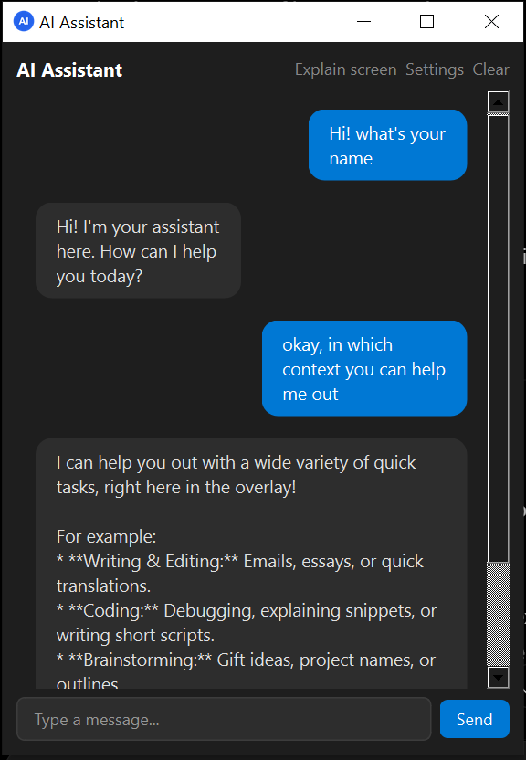

# Desktop AI Assistant

A small AI assistant for Windows that **lives on your screen** instead of in a browser tab.

You are coding in VS Code, watching a lecture in Edge, or solving a problem on LeetCode and something is not clear. Press a hotkey (or click the floating bubble), a small chat window opens on top of whatever you are doing, and you can ask right there. No tab switching, no copy and paste.

> Academic project for the Artificial Intelligence course. Built by a team of three.

---

## Features

| Feature | Description | Status |
|---|---|---|
| Global hotkey | Press `Ctrl+Space` in any app to open the assistant | Done |
| Explain selected text | Select text anywhere, press the hotkey, get an explanation | Done (capture) |
| Context awareness | Detects whether you are in VS Code, a browser or another app and adapts the answer style | Done (detection) |
| Explain my screen | Takes a screenshot and asks the AI about it | Done (capture) |
| Gemini AI | Cloud AI answers using the Google Gemini API | Done |
| Local AI fallback | Works offline with a local model through Ollama | Done |
| Secure API key | Key is stored in Windows Credential Manager, never in the code | Done |
| Floating bubble and chat window | Always-on-top, draggable overlay | In progress |
| System tray icon | Open / Settings / Quit from the tray | In progress |
| Streaming answers | Text appears word by word | In progress |
| Chat history | Old chats are saved in a local SQLite database | In progress |
| Markdown and code blocks | Formatted answers with a copy button | In progress |
| Start with Windows | The assistant starts automatically when you log in | Done |
| Windows installer | One-click `.exe` installer | Planned |

<!-- Update the Status column at the end of every week. Allowed values: Done / In progress / Planned -->

---

## How it works

```
Hotkey / bubble click
        |
        v
Capture (selected text, screenshot, active app)
        |
        v
GUI window  --->  AI client (Gemini or Ollama)  --->  streamed answer
                         |
                         v
                  SQLite chat history
```

See the full diagrams in [docs/architecture.md](docs/architecture.md).

---

## Tech Stack

| Part | Technology |
|---|---|
| Language | Python 3.12 |
| GUI | PySide6 (Qt for Python) |
| AI (cloud) | Google Gemini API (`google-genai`) |
| AI (local) | Ollama |
| Global hotkey | `pynput` |
| Clipboard | `pyperclip` |
| Screenshot | `mss` and `Pillow` |
| Active window | `pywin32` and `psutil` |
| Secure key storage | `keyring` |
| Chat history | SQLite |
| Markdown rendering | `markdown` and `Pygments` |
| Tests | `pytest` |
| Packaging | PyInstaller and Inno Setup |

---

## Installation

### Option 1: Installer (recommended)

Planned for release v1.0.0. Download `DesktopAIAssistant-Setup.exe` from the [Releases](../../releases) page and run it.

### Option 2: Run from source (Windows 10/11)

**1. Install** [Python 3.12](https://www.python.org/downloads/) (tick **Add python.exe to PATH**) and [Git](https://git-scm.com/download/win).

**2. Clone and enter the project folder**

```bash
git clone https://github.com/ali-hassnain-se/Academic-Projects.git
cd Academic-Projects/desktop-ai-assistant
```

**3. Create a virtual environment and install packages**

Git Bash:
```bash
python -m venv venv
source venv/Scripts/activate
pip install -r requirements.txt
```

PowerShell:
```powershell
python -m venv venv
venv\Scripts\Activate.ps1
pip install -r requirements.txt
```

**4. Check the setup**

```bash
python tests/manual/check_env.py
python -m pytest
```

**5. Run the app**

```bash
python main.py
```

> Run it on Windows, not in WSL. The hotkey, screenshot and overlay features need the Windows desktop.

---

## Getting a Gemini API key

1. Open [Google AI Studio](https://aistudio.google.com/apikey) and sign in.
2. Click **Create API key** and copy it.
3. Paste it into the assistant's **Settings** window. It is stored in Windows Credential Manager.

<!-- TODO (Member A / B): confirm the exact Settings steps once the settings dialog is merged -->

Never put the key in the code or in a commit. Each team member uses their own key.

### Optional: offline mode with Ollama

1. Install [Ollama](https://ollama.com/download).
2. Download a model, for example: `ollama pull llama3.2`
3. Choose Ollama in Settings. The assistant then works without internet.

---

## Usage

| Action | How |
|---|---|
| Open the assistant | Press `Ctrl+Space` in any app, click the floating bubble, or use the tray icon |
| Ask a question | Type it and press `Enter` |
| Explain selected text | Select text in any app, then press the hotkey |
| Explain my screen | Click the **Explain my screen** button |
| Close the window | Press `Esc` |
| Start with Windows | Turn on **Start with Windows** in Settings |

The default hotkey is set in `assistant/config.py` (`DEFAULT_HOTKEY`).

<!-- Add screenshots here later:  -->

---

## Project structure

```
desktop-ai-assistant/
├── main.py                  # entry point
├── requirements.txt
├── pytest.ini
├── assistant/
│   ├── config.py            # defaults (hotkey, model, window size)
│   ├── ui/                  # GUI: bubble, chat window, tray, settings
│   ├── ai/                  # Gemini / Ollama clients, prompts, errors
│   ├── storage/             # API key storage, SQLite chat history
│   └── system/              # hotkey, selected text, screenshot, active app, auto-start
├── tests/                   # automatic tests (pytest)
│   └── manual/              # scripts to try features by hand on Windows
├── docs/                    # architecture, testing checklist, guides
└── assets/                  # icons and images
```

---

## Running the tests

```bash
python -m pytest                      # automatic tests
python -m tests.manual.try_hotkey     # try the hotkey (Windows)
python -m tests.manual.try_capture    # try selected text capture (Windows)
python -m tests.manual.try_screen     # try screenshot + active app (Windows)
```

The manual test checklist for the whole app is in [docs/TESTING.md](docs/TESTING.md).

---

## Team

| Member | Role | Main folders |
|---|---|---|
| Member A: Nafees Ur Rehman | GUI: overlay, tray, settings, themes, installer | `assistant/ui/`, `assets/`, `installer/` |
| Member B: Muhammad Hamza | Backend: Gemini, Ollama, prompts, history, API key | `assistant/ai/`, `assistant/storage/` |
| Member C: Rana Ali Hassnain | System integration, repository owner, testing, documentation, release | `assistant/system/`, `tests/`, `docs/` |

### How we work

- Every task is a GitHub Issue; progress is tracked on the project board.
- Nobody pushes to `main`. Each task gets a branch (`feature/...`), a Pull Request and a review from another member.
- Commit messages follow `type(area): message`, for example `feat(system): add global hotkey listener`.

---

## Roadmap

| Milestone | Date | Goal |
|---|---|---|
| M1 | 25 Oct | Hotkey opens the assistant and Gemini answers |
| M2 | 1 Nov | Streaming chat, history, "Explain this" |
| M3 | 8 Nov | Feature complete (screen explain, context modes, Ollama) |
| M4 | 15 Nov | Installer, documentation, release v1.0.0 |

---

## Known limitations

- Gemini needs an internet connection and is subject to the free-tier request limits (use Ollama for offline work).
- Windows only for now (hotkey, screenshot and auto-start use Windows APIs).
- The hotkey does not work over apps that run as Administrator.
- If a user disables the app in Task Manager > Startup, Windows will not let the app turn auto-start back on by itself.
- Some antivirus programs may warn about unsigned `.exe` files or programs that listen for keyboard shortcuts.

## Future work

- Voice input
- macOS and Linux support
- More context modes (for example PDF readers and code review)

---

## License

Academic project. License to be decided by the team.