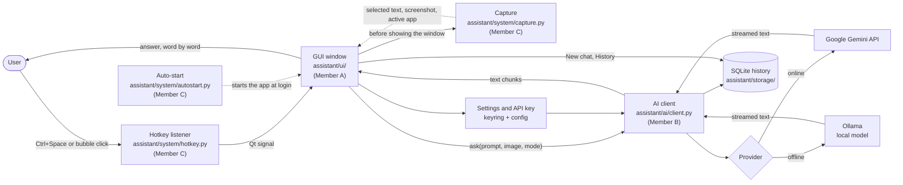
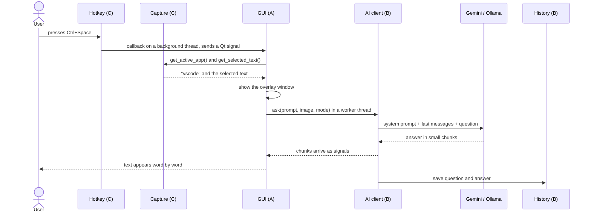
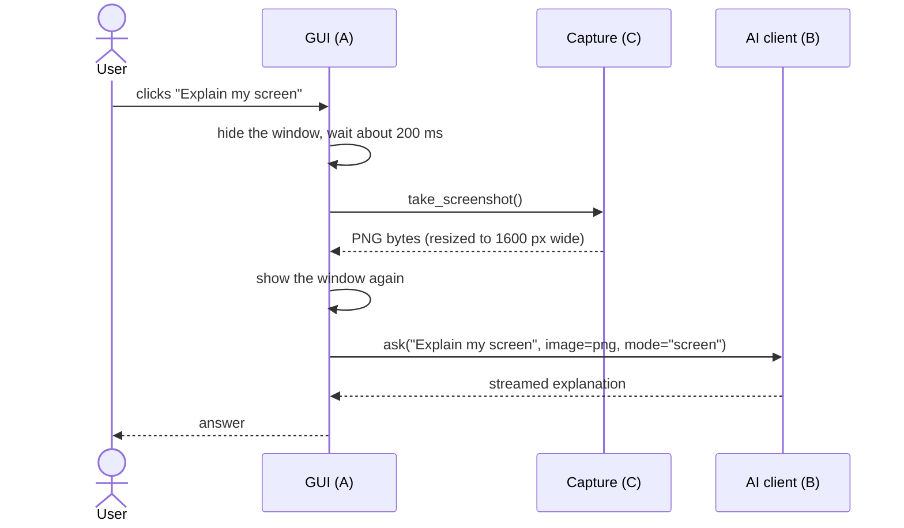

# Architecture

This page shows how the Desktop AI Assistant is built. GitHub draws the diagrams below automatically (they are written in Mermaid).

## 1. Big picture

## 2. What happens when the user presses the hotkey

Why `get_active_app()` and `get_selected_text()` are called **before** the window is shown: once our window opens it takes the focus, and the active app would always be "other".

## 3. Explain my screen

The window is hidden first so it does not appear in its own screenshot.

## 4. Threads

| Thread | What runs there | Rule |
|---|---|---|
| Main (GUI) thread | All windows, buttons and text | Only this thread may change widgets |
| Hotkey thread (created by `pynput`) | The hotkey callback | Must only send a Qt signal, never touch widgets |
| Worker thread | `ask()` (network call, streaming) | Sends each chunk back to the GUI as a signal |

## 5. Layers and ownership

| Layer | Folder | Owner | Talks to |
|---|---|---|---|
| GUI | `assistant/ui/` | Member A | System, AI client, history |
| AI and data | `assistant/ai/`, `assistant/storage/` | Member B | Gemini, Ollama, SQLite, keyring |
| System | `assistant/system/` | Member C | Windows (keyboard, clipboard, screen, registry) |

The layers only talk to each other through the agreed functions: `ask()`, `get_api_key()`, the history functions, `get_selected_text()`, `take_screenshot()`, `get_active_app()`, `register_hotkey()` and `enable_autostart()`.

## 6. Exporting a picture (for slides)

1. Open https://mermaid.live
2. Paste the code of one diagram (the part between the three backticks, without the word `mermaid`).
3. Click **Actions > PNG** and save it into `docs/images/`.